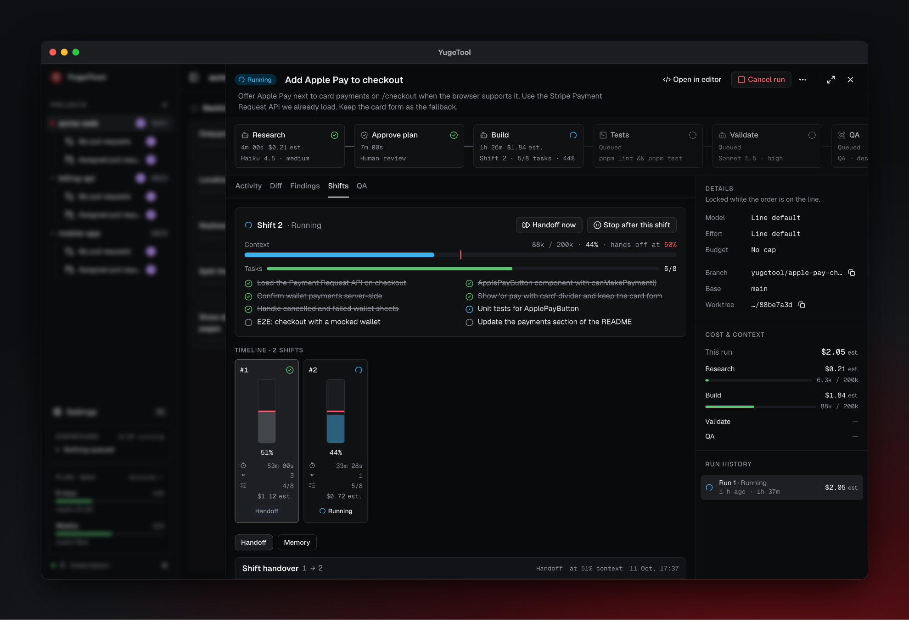
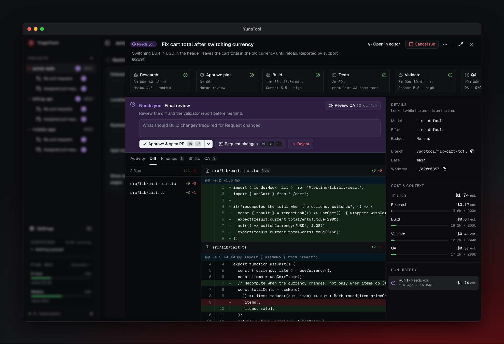
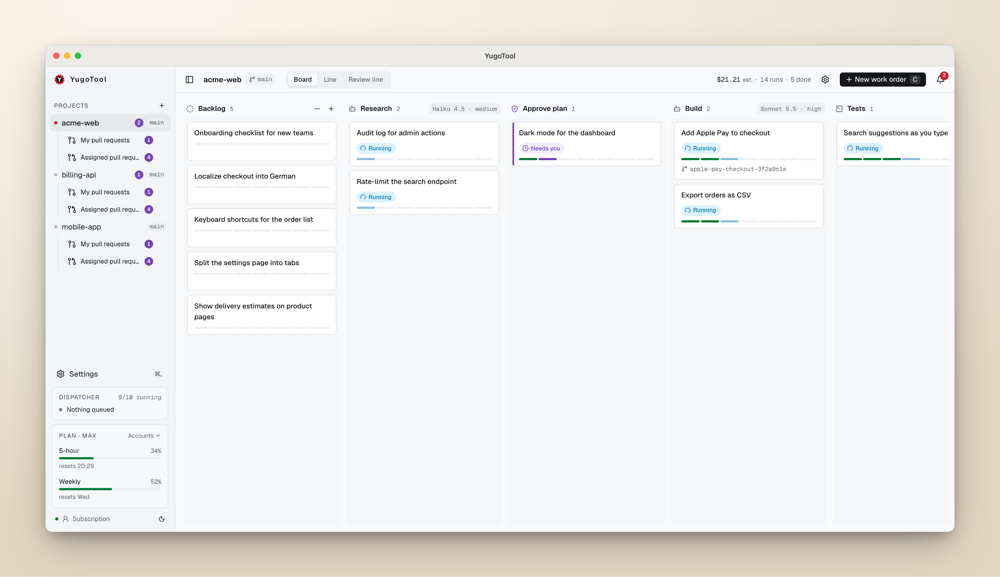

<div align="center">


# YugoTool · frontend

**The UI of [YugoTool](https://github.com/cherry-it/yugotool-backend), a local software factory for Claude Code.**<br />
A board of work orders moving down an assembly line of agents, a canvas for the line, and a live run panel with activity, diffs, QA screenshots and gate approvals.

[](LICENSE)
[](https://react.dev)
[](https://vite.dev)
[](https://www.typescriptlang.org)
[](https://tanstack.com)
[](https://tailwindcss.com)
[](https://reactflow.dev)

[Backend & desktop app](https://github.com/cherry-it/yugotool-backend) · [Run it](#run-it) · [Map](#map) · [Contributing](#contributing)

<br />

<picture>
  <source media="(prefers-color-scheme: light)" srcset="docs/screenshots/board-light.png" />
  
</picture>

</div>

## What's in here

- **Board**: work orders as cards in the columns of the project's line, with live status, cost and what's waiting on you.
- **Line editor**: stations and gates on a React Flow canvas: role, model, tools, prompt and skills per station.
- **Run panel**: the station stepper, streamed agent activity, the diff, QA before/after screenshots and the gate buttons.
- **Pull requests**: your PRs and review requests per project, with YugoTool reviews and findings ready to post.
- **Settings**: Doctor, Claude accounts and plan usage, notifications, knowledge sources.
- **Offline-first**: the query cache persists to IndexedDB, so the board renders instantly and survives a restart. Server-sent events keep every window in sync.

<details>
<summary><b>More screenshots</b></summary>
<br />

|                                                                                               |                                                                                                            |
| --------------------------------------------------------------------------------------------- | ---------------------------------------------------------------------------------------------------------- |
|            |  |
|  |                                  |
|                                  |                               |

</details>

## Run it

The UI needs the YugoTool API. Start it from [yugotool-backend](https://github.com/cherry-it/yugotool-backend#development) first, then:

```bash
pnpm install
pnpm dev          # http://localhost:4800, proxies /api to the API on :4810
```

In production the API serves `dist/` itself (`pnpm build`), whether from the supervisor or the desktop app. Inside the desktop app the page also gets `window.yugotoolDesktop` (native folder picker, theme sync); in a browser it is absent.

## Stack

React 19 · Vite 8 · TypeScript (strict) · TanStack Router / Query / DB / Form · React Flow · dnd-kit · shadcn/ui · Tailwind CSS v4 · Shiki · Vitest · Playwright.

## Map

| Concern                                                                    | Where                                                                 |
| -------------------------------------------------------------------------- | --------------------------------------------------------------------- |
| Routes (`/`, `/settings`, `/projects/$projectId?view=board\|line&wo=<id>`) | `src/app/routes`                                                      |
| Projects, line canvas, preview and routes settings                         | `src/features/projects`                                               |
| Work orders: board, panel, queue actions                                   | `src/features/work-orders`                                            |
| Runs: stepper, activity, diff, QA review, gates                            | `src/features/runs`                                                   |
| Pull requests and reviews                                                  | `src/features/pull-requests`                                          |
| Settings, Doctor, plan usage, dispatcher                                   | `src/features/settings`, `src/features/system`                        |
| HTTP client and error shape                                                | `src/lib/api-client.ts`                                               |
| SSE → cache invalidation                                                   | `src/lib/realtime.ts`                                                 |
| Offline cache (Query → IndexedDB)                                          | `src/lib/persister.ts`, `src/app/provider.tsx`                        |
| API contract mirror                                                        | `src/lib/contracts.ts` (mirrors `@yugotool/contracts` in the backend) |

## Contributing

Issues and pull requests are welcome. Change the API contract in the backend first, then mirror it in `src/lib/contracts.ts`. Before a PR, run:

```bash
pnpm lint && pnpm format:check && pnpm typecheck && pnpm test && pnpm build
```

Conventions are in [`CLAUDE.md`](CLAUDE.md).

## License

[MIT](LICENSE) © 2026 Bojan Ratković
